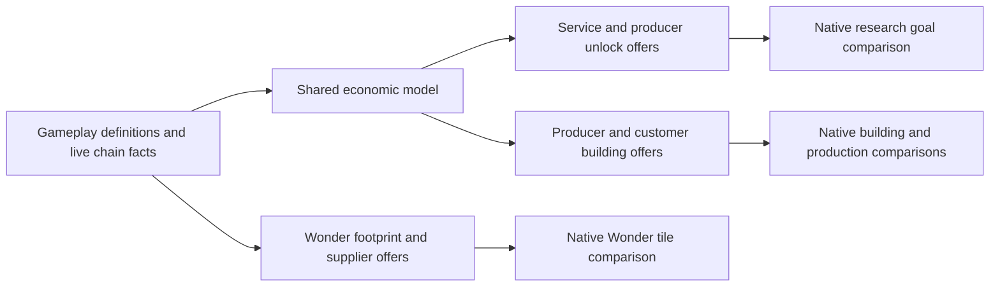

# CSC research and later-stage investment guidance

Problems 6.1, 7.1–7.2, 8.1, 9.1, 10.1–10.2, 11.1–11.2 and 12.1 are in scope for Bakers and Tailors. The strategy decisions in 6.2, 9.2 and 12.2 are deferred. The candidate reuses the native research, building and Wonder-site comparisons in CE. Gameplay SQL and the CE DLL are unchanged for this slice.

| Decision | Candidate policy | Evidence |
| --- | --- | --- |
| 6.1, 9.1, 12.1 Service unlock | Offer the one remaining topic when the producer, customer and authored material requirements are already met. Pool distinct chains and combine Housing at the receiving city before pricing it. | Ordinary Fractal verified the Feudalism comparison, unlock and Storekeeper. Québec verified the same sequence for Opera and Ballet and Stage Manager. A ready Stage 3 chain with an outstanding civic still needs a targeted replay. |
| 7.1, 7.2 Stage 3 producer | From population 7, price the unlock against the expected exchange. From population 10, bid for the eligible building against other orders. Price working venues and the modeled local returns. | Offline tests cover the population gates, live eligibility and queued orders. The native Guilds comparison and completion are verified in Pangaea. Native Bakery construction is verified in a matched replay. |
| 8.1, 11.1 Customer building | Price an eligible mapped adjacent customer building for its operating producers, including unique replacements. Group links that share one customer order and round their population return together. | Tests cover shared recipients, population rounding and replacements. On ordinary Fractal, Urumqi's Market and Qaraqorum's Zoo both received their exact bids, completed and paid both sides of the exchange. |
| 10.1, 10.2 Stage 4 producer | Use the same population gates and require feasible Base and Specialty supply. Supplier readiness constrains material returns. Each distinct missing new improvement carries a share of a Builder's cost. | Offline tests cover missing or late supply, the charge cost, and repair. A treatment Café completed sooner. Humanism reached the civic comparison and completed at the same time in both arms. |
| 11.2 Wonder site | Use the existing native Wonder-site bid on adjacent owned tiles with viable Base and Specialty. Give more weight as each class becomes operational and preserve material protection. | Offline tests cover material admission and plot scoping. Live comparison, placement and exchange are open. |

Astra recommended pricing the effect of one physical queue order at a time through the existing ledger. The controlled replays will check how the applied bid competes with other research and production, then follow selection through to construction or a realised Service. The full games will keep Problem 3 supplier timing visible for both material classes.

## Fractal checkpoint from turn 150 to 165

Both arms reloaded the same verified ordinary save and used Steam GameCore build 26595377, the same CE package and identical gameplay content. The treatment differed in five existing CSC Lua files. The control retained the preceding CSC guidance for Problems 1–5. Both arms reached turn 165 and restored the local mod settings.

The treatment published 40 Stage 3 producer offers and 50 Stage 4 producer offers across the replay, with no later customer or research offers. Native queue receipts include Bakery and Café comparisons. Angkor Wat's Café score rose from 98,551 to 114,935 Q8 in one queue comparison. Both arms chose a Trader at turn 154. At turn 157 the treatment chose the Café, while the control chose a Theater Square project. The control first logged a Café production preference at turn 161. The treatment Café was complete at turn 165 on Bakers plot 2869 with working Flax and Berries. Its adjacent customer was the Stage 2 Granary, so this case qualifies producer construction while the later customer exchanges still need their own cases.

At Angkor Thom, the Bakery's queue comparison rose from 222,474 to 238,858 Q8. The Bakery appeared in the turn-153 production choice log and completed with 107.6 Production against an 80 cost on turn 154. Both arms built it. The treatment moved the Café ahead of the project while leaving the earlier Trader and this Bakery outcome intact.

| Working producers at turn 165 | Previous guidance | Combined candidate |
| --- | ---: | ---: |
| Stage 2 | 12 | 13 |
| Stage 3 | 7 | 7 |
| Stage 4 | 2 | 3 |

The 64-utility ceiling applied to 87 of 90 producer offers. Later replays retain the raw prices and per-building native receipts to assess calibration. Raw evidence is under `Desktop/Codex/csc-ai-stage6-12-20261121/fractal-150-165-v2`.

## Fractal checkpoint from turn 100 to 115

The treatment published 13 Stage 4 producer research offers for player 5's Humanism. The native civic comparison recorded five uses. The applied amounts ranged from 12,998 to 14,335 Q8. The stock goal stayed ahead at each comparison. In the last recorded comparison, Humanism was the immediate research step toward the higher-scoring goal. Both arms owned Humanism by the turn-113 observation. This is a representative research bid that reached the selector and deferred to ordinary priorities.

The same replay published 52 later building offers and recorded 22 exact building receipts. The passive Service observer read 33 gameplay effect attachments with no catalogue omissions. It verified one operating Storekeeper link for each of the 14 sampled turns in both arms. Raw evidence is under `Desktop/Codex/csc-ai-stage6-12-20261121/fractal-100-115`.

Astra identified Québec's ready Stage Manager as the clearest Service-unlock replay. The city starts with a working Fashion House, adjacent Amphitheater, Flax and Silver and still needs Opera and Ballet. A separate turn-200 Fractal checkpoint has a live Café at Bakers plot 1503 and an adjacent Entertainment Complex at 1576 missing a mapped customer building. These are the next targeted replay cases.

## Québec's Stage Manager from turn 250 to 265

The original turn-250 world already had the working Fashion House at 545, Flax at 544, Silver at 620 and the adjacent Amphitheater at 471. Québec's player lacked Opera and Ballet. Both arms preserved those facts and let the AI research normally.

The treatment published 14 Opera and Ballet offers worth 12,373 Q8 for this ready chain. The native civic receipt identified this topic in five publication windows. Several other civic goals stayed ahead. In the turn-263 receipt, Opera and Ballet was the stock and adjusted goal and the immediate step. Both arms owned the civic and activated the Stage Manager effect on the same Amphitheater at turn 264. The native Service watcher observed all 14 interior turns. This establishes delivery and actual operation for 12.1, with equal timing in the two arms.

Raw evidence is under `Desktop/Codex/csc-ai-stage6-12-20261121/quebec-250-265`.

## Missing customers from turn 200 to 215

The ordinary replay kept the Café at plot 1503 and Entertainment Complex at 1576 intact. Neither arm built the mapped Zoo, and the treatment offered no bid on that venue. A controlled replay can supply its Arena prerequisite and verify the Zoo's immediate eligibility before judging delivery.

The same treatment found a different opportunity for player 5's Market. It published 12 customer offers worth 16,384 Q8 each against a raw estimate of 26,940 Q8. Native receipts show both queue and ordinary nominations applied to that Market. The Market remained out of production during the sample, so the controlled Market replay exercises selection and the realised exchange separately.

The CSC publisher averaged 2.046 seconds per turn in control and 2.097 seconds in treatment over 15 complete measurements. Maximums were 2.502 and 2.330 seconds respectively. This short replay measures the whole publisher during each world’s play. The ordinary campaign will measure longer-run overhead. Raw evidence is under `Desktop/Codex/csc-ai-stage6-12-20261121/entertainment-200-215`.

## Early research and the controlled Market rebuild

In the turn-50 trial both arms received the same missing Water Mill at Bakers plot 2497. The preparation verified two working Base suppliers, its adjacent Granary and unowned Feudalism and Guilds. The treatment sent and reached the native comparisons for both topics. Feudalism completed and Storekeeper activated at another intact Quarter for the same player on turn 71 in both arms. Both prepared suppliers had stopped working by the turn-72 census. The Guilds receipt on turn 71 identifies it as the immediate step toward a longer goal. The replay ended before it recorded the completed civic.

In the Market fixture, removing the Stage 3 customer at plot 913 removed both observed population payments. The treatment's exact offer reached both building selectors in player 5's city, and neither arm rebuilt this Market by turn 215. The same treatment offered a Market in Mahendraparvata, where CE applied the bid in the production selector and the queue finished the Market on turn 205. The control also built that Market. The ordinary campaign now logs positive population-payment quantities for both sides of each assembled Stage 3 and 4 exchange.

Raw evidence is under `Desktop/Codex/csc-ai-stage6-12-20261121/storekeeper-50-72` and `market-200-215-v2`.

The normal guided Pangaea arm closed the earlier Guilds timing gap. Player 5 published 16 Stage 3 producer bids for Guilds (civic index 19) from turns 74 through 89. The turn-78 receipt captured the bid while the immediate step was still a different civic. The turn-83 receipt applied 12,109 Q8 and recorded Guilds as the immediate step while the longer goal remained civic 24. The watcher first observed Guilds owned at turn 91. These events all precede the verified turn-200 save. The matched early replay and the normal-game completion together qualify 7.1, with the longer native goal preserved.

## Legal Zoo and Wonder qualification

Adding only the missing Arena on both copies made the Zoo eligible at the Entertainment Complex beside the Café. The treatment then made 15 offers for that exact Zoo. Three receipts show a queue write, and two show a write in the ordinary nomination selector. Both cities still pursued other work through turn 215. This verifies delivery for 11.1 while leaving construction and payment open. Keep the current 64-utility cap while observing more opportunities.

The same archived map had no admissible Bolshoi footprint beside a Tailors layout with both material classes in the Wonder scout. That case ended before any placement score comparison. The ordinary runs will record Wonder placement and exchange quantities and provide new candidate worlds for a matched placement case. Raw evidence is under `Desktop/Codex/csc-ai-stage6-12-20261121/zoo-200-215` and `wonder-200-220`.

The Sacristan trials lacked a valid starting opportunity. The first city's adjacent plots did not admit a Holy Site. The second archive already had Divine Right for the player with a supplied Tailors and Temple. Both setups ended before editing a copy. Keep 9.1 open and look for unowned topics in the ordinary samples.

REA and Ghidra also established a narrow experimental reset for this case. On Steam XP2 `4de40abf`, the Lua `SetCivic` entry at RVA `6f12f0` forwards the Boolean to the native setter at `284870`. Clearing the ownership flag returns before the completion broadcast. The `SetCulturalProgress` thunk at `6f13a0` uses the numeric Q8 argument converter at `6f0450` and the progress writer at `284bb0`. A diagnostic can clear both fields on copies of the same archived world, then create the missing Tailor so its attachment was never active under the old civic state. The actual AI must choose and complete the civic again. This setup has no role in ordinary play or shipping guidance.

The current ownership routine evidence is `ev_73c6c355b1d543b036c45af5fea9bc5d1ea20ecafe3bb06e3900a8c5a56ecbc9`. The progress writer clamps to the topic's cost. It records positive progress deltas in the accumulated culture counters, while a decrease only changes the topic's progress. The fixture resets the two observed topic fields and leaves the prior game history in place.

The live turn-100 control verified the split Lua surface. `PlotInfo` reported Divine Right as owned with stored progress zero before preparation. The Gameplay script confirmed both setters, cleared ownership and prepared the producer. `PlotInfo` then reported the civic unowned with progress zero. The Gameplay context had no progress getter. The readbacks establish the starting civic state for this copy. The AI then plays toward the unlock under ordinary research rules.

## Preselected full-game pairs

Each pair uses a fresh Small Online game through turn 250 on the shared controller, with the same map and game seed, gameplay and UI mods, and pinned Firaxis GameCore and CE build. The control retains CSC gameplay with guidance and private customer adjacency disabled. The treatment runs the integrated CSC policy. Both use stock AI. Seeds are fixed before qualification begins.

| Map | Map seed | Game seed |
| --- | ---: | ---: |
| Continents | 793412556 | 1390346751 |
| Fractal | 28111119 | 38111119 |
| Pangaea | 27061117 | 37061117 |

Report placement, suppliers, producer and customer completions, Wonders, working exchanges, active Service turns, unlock timing, missed opportunities, competing work and guidance processing time for each pair. Count Service duration from active native effects on specific recipients.

Campaign artifacts and the frozen package are under `Desktop/Codex/csc-ai-stage6-12-20261121/campaign`.

Shadow lost the first Pangaea stock process at turn 100. The restart reached turn 50 and the controller stopped when that path produced the old native checkpoint name. Both attempts are archived. Intermediate checkpoint names now include a per-run suffix, so a retry can start the same ordinary world while preserving saves from the previous attempt.

The guided Pangaea arm started normally and saved turn 200. A hidden `FIRST_MEET_NEAR_INITIATOR` invitation to observer 0 blocked its turn-205 autoplay window. The native log and the live session agreed on sender 5 and recipient 0. The original session closed cleanly. Reloading the exact save matched all 249 structural rows and reproduced the block as `FIRST_MEET_NO_MANS`. The controller now checks the three shipped initial invitation variants, requiring the latest NONE/INITIAL/Processing Immediately record, exact live participants and active autoplay. The second replay applied the shipped `CHOICE_EXIT` at turn 205 and continued past the stall. Keep the original prefix and the successful recovery raw logs, and use the save boundary when joining Service clocks and timing.

## Continents through turn 250

Both games matched the opening map, roster, start plots and units and reached the endpoint. The stock arm kept CSC gameplay and withheld the publisher and private customer placement bonuses. Both arms sampled 200 shared Service turns. The UI watcher omits a number of controller handoff turns, so the table reports active links only on shared clocks.

| Turn-250 count | Bakers stock | Bakers combined | Tailors stock | Tailors combined |
| --- | ---: | ---: | ---: | ---: |
| Quarter foundations through turn 250 | 13 | 15 | 14 | 3 |
| Completed Quarters | 13 | 14 | 13 | 3 |
| Working Base supplier links / adjacent links | 2 / 3 | 15 / 17 | 1 / 1 | 3 / 3 |
| Working Specialty supplier links / adjacent links | 0 / 0 | 3 / 4 | 0 / 0 | 0 / 0 |
| Stage 2 / 3 / 4 completed producers | 11 / 8 / 5 | 13 / 11 / 4 | 9 / 8 / 6 | 3 / 1 / 1 |
| Stage 2 / 3 / 4 working producers | 11 / 8 / 5 | 13 / 11 / 3 | 9 / 8 / 6 | 3 / 1 / 1 |
| Stage 2 / 3 / 4 completed customer hosts | 4 / 0 / 0 | 12 / 8 / 1 | 0 / 1 / 2 | 0 / 2 / 3 |
| Stage 2 / 3 / 4 working customer hosts | 4 / 0 / 0 | 12 / 7 / 1 | 0 / 1 / 2 | 0 / 2 / 3 |
| Stage 2 physical exchange pairs | 3 | 12 | 0 | 0 |
| Quarters with a working Stage 2 pair and working Base | 1 | 10 | 0 | 0 |
| Stage 3 / 4 exchanges with positive quantities on both sides | 0 / 0 | 5 / 0 | 0 / 0 | 1 / 1 |
| Active Stage 2 / 3 / 4 Service link-turns | 54 / 0 / 0 | 801 / 154 / 0 | 0 / 0 / 0 | 0 / 47 / 0 |

The combined arm observed 11 distinct Storekeeper, six Innkeeper and one Sacristan links. A Tailors Fashion House at 2692 paid an adjacent Amphitheater at 2693 in both directions at the endpoint. Both arms had zero mapped Wonder customer links. The combined arm published 590 later building offers and logged 234 exact receipt rows. This seed produced no later producer or Service research offers and no Wonder offers. The combined publisher's wall time averaged 1.195 seconds and reached a maximum of 2.887 seconds across 250 publications. The separately timed managed native scoring averaged 14.13 milliseconds and reached 27.97 milliseconds.

The 590 offers cover 16 distinct player/city/building keys. Fourteen reached a native comparison and thirteen received a write. Both Stage 4 producer targets received comparisons. The two interior keys without writes were Market offers. Player 2's turn-202 offer was compared without a write and player 5's turn-232 offer expired without a recorded comparison. A Bakery offer on turn 250 had no subsequent production window.

The first Bakers foundation moved from turn 71 to 21. The first Tailors foundation moved from turn 60 to 129. Foundation counts are original AI placement events, so they also include work that was still under construction or had disappeared from the original AIs' holdings by turn 250.

## Fractal through turn 250

Both arms reached turn 250 from the verified common opening. The Service watcher provided 199 shared clocks.

| Turn-250 count | Bakers stock | Bakers combined | Tailors stock | Tailors combined |
| --- | ---: | ---: | ---: | ---: |
| Quarter foundations through turn 250 | 16 | 14 | 13 | 5 |
| Completed Quarters | 13 | 13 | 9 | 5 |
| Working Base supplier links / adjacent links | 0 / 2 | 12 / 15 | 2 / 2 | 5 / 6 |
| Working Specialty supplier links / adjacent links | 0 / 1 | 2 / 4 | 0 / 1 | 2 / 2 |
| Stage 2 / 3 / 4 completed producers | 12 / 9 / 5 | 13 / 10 / 8 | 8 / 8 / 4 | 5 / 3 / 4 |
| Stage 2 / 3 / 4 working producers | 11 / 8 / 5 | 13 / 10 / 8 | 7 / 7 / 4 | 3 / 3 / 3 |
| Stage 2 / 3 / 4 completed customer hosts | 5 / 2 / 0 | 9 / 5 / 1 | 0 / 1 / 0 | 0 / 2 / 2 |
| Stage 2 / 3 / 4 working customer hosts | 5 / 2 / 0 | 9 / 5 / 1 | 0 / 1 / 0 | 0 / 2 / 2 |
| Stage 2 physical exchange pairs | 3 | 9 | 0 | 0 |
| Quarters with a working Stage 2 pair and working Base | 0 | 6 | 0 | 0 |
| Stage 3 / 4 exchanges with positive quantities on both sides | 2 / 0 | 4 / 1 | 1 / 0 | 2 / 1 |
| Active Stage 2 / 3 / 4 Service link-turns | 0 / 0 / 0 | 573 / 80 / 0 | 0 / 0 / 0 | 0 / 193 / 0 |

The combined arm observed seven distinct Storekeeper, four Innkeeper and two Sacristan links. None of the four completed ordinary games had a mapped Wonder customer link. On Fractal the treatment published 919 later building offers and logged 340 exact receipt rows. All 27 distinct player/city/building keys received a write at least once. The publisher averaged 1.325 seconds and peaked at 2.410 seconds across 250 publications. The separate native managed-cell timing averaged 15.74 milliseconds and peaked at 28.83 milliseconds.

First foundations moved from turn 29 to 17 for Bakers and from 38 to 28 for Tailors. Stage 2 supplied Quarter counts join working producers and customers to an operating Base supplier. They count each Quarter once even if it has several working pairs. Stage 3 and 4 positive payments come from actual game properties for both recipients.

- **6.1, Feudalism.** Player 3 received eight offers from turn 62 through 69. The native turn-68 receipt records Feudalism as the immediate research step toward the longer goal. Player 3 first owned Feudalism at the turn-71 observation, when Storekeeper also operated from the offered Bakers source `655367`.
- **8.1, Market.** Player 4's Urumqi (city `262147`) published a Market offer on turn 203. The next receipt records the exact queue write at 16,384 Q8. The native chooser nominated it on turn 203, and the queue reached 117.6 of 60 production on turn 205. The turn-225 and turn-250 censuses record the Bakery at 1823 and Market at 1748 paying 26 units on each side. The turn-200 census precedes the exchange.
- **11.1, Zoo.** Qaraqorum (player 4, city `65536`) went from no Zoo exchange to a native Zoo submission on turn 209. The exact receipt records a queue write and the ordinary nomination receipt records a write. Production reached 245 of 180 on turn 213. The turn-250 census records the Café at 2189 and Zoo at 2115 paying four units each.
- **11.2, Wonders.** Repeated publications produced 924 offers and zero exact native matches. The CE counter records an exact match before checking the score sign or applying the cap, so the next check is candidate admission. Astra traced two natural orders. Angkor Thom built Broadway two tiles from its Tailors, with both plots touching the Quarter and its Theater already occupied. Qaraqorum had both materials earlier and later pursued Sydney Opera House. The nearest Harbor was three tiles from the Quarter, beyond the range for one site to touch both. Scout the turn-200 checkpoint for an admissible footprint before evaluating the premium.

On the benchmark GameCore `4de40abf`, the Wonder loop in RVA `3e2360` first calls `CanHaveWonder` at `25bab0` and requires a nonnegative combined delay estimate. Only then does the call at `3e3a5a` pass the exact coordinates to Building NetValue at `52a030`. The return at `3e3a5f` feeds the plot's building-score entry. The UI legality result is useful for scouting. The earlier-packet CE receipt establishes actual native comparison and score application. Current disassembly and decompilation evidence is `ev_1b56ac155dd8ebc6783ba10f4fd53759c847380afbc858a5776b9e62edb151ee` and `ev_6dede9f8c29725b7dd51f67e0f8c94ac78fe47941baedf3ded743ec3ad0fb77b`.

Evidence is under `Desktop/Codex/csc-ai-stage6-12-20261121/campaign/fractal-combined` in the native receipts, `AI_CityBuild.csv`, `City_BuildQueue.csv`, `full-census-{200,225,250}.json` and `observed-services.json`.

### Supplier timing across the first two pairs

Among buyers with legal Base work still needed when a supplier first became actionable, working Base at buyer completion plus ten turns went from 2 of 3 to 3 of 8 on Continents and from 0 of 3 to 5 of 10 on Fractal. All eight on-time treatment cases were Bakers. Tailors reached zero of three across the two treatment arms in that cohort, with more Tailors already supplied when first actionable. For Specialty, the comparable work-needed cohort contained two treatment Bakers on Fractal and one made the deadline. World divergence changes which buyers and plots get into this cohort.

The supplier survey detected three outages in each of the four arms. The stock arms recorded no recovery by turn 250. The treatment recovered two Continents Tailors Base links in 7 and 22 turns and one Fractal Tailors Specialty link in 3 turns. Three treatment outages were still unresolved in those surveys at turn 250. These are working supplier links while the buyer remains eligible, independent of whether the Service is active.

## Pangaea stock Broadway observation

Hagmatana, player 3 city `262147`, submitted native Broadway contract `2944` on turn 144, chose it for production on turn 150, and completed it on turn 169. The Wonder at 1354 borders its Tailors at 1428, which the city completed on turn 59. The turn-200 and turn-225 censuses show the Fashion House and Broadway each receiving two units. At turn 250 the Fashion House was pillaged and that exchange was absent. The positive turn-250 Tailors payment in the same game belonged to an Amphitheater at 3004 serving a different Tailors at 2929.

The native `DISTRICT_WONDER` placeholder at 1354 already reported `IsComplete` at foundation on turn 150. The production queue first paid 86.2 of 810 on turn 151 and reached 814.5 on turn 169, when contract 2944 completed. The Wonder-building inventory and the later payment observations establish the completed venue.

The stock Hagmatana link identifies a native-legal physical layout and a witnessed selection and production window. The placement guidance requires viable Base and Specialty because it targets a supportable chain. The stock city had no surveyed legal supplier of either class at that Quarter, and the actual Wonder transaction can pay once the two buildings operate. The paired 11.2 replay still needs a CSC bid at the upstream site comparison.

Astra reviewed the fallback. A replay must reach the same world before the turn-144 contract and confirm two distinct legal supplier plots while Broadway's footprint remains available. The diagnostic runner can now follow ordinary play from an archived checkpoint to an exact earlier preparation turn. It verifies matched structure there before applying any controlled setup. Prefer a naturally viable candidate in a guided archive first. Reusing Hagmatana's stock save would need an explicit stock-derived diagnostic with its original package identity verified and the same supply and publisher setup in both arms.

## Pangaea through turn 250

The stock arm reached turn 250 from its ordinary start. The guided arm used its original observations up to the exact turn-200 save and its matched-state continuation through turn 250. The successful continuation closed the hidden first-meet invitation at turn 205 and restored the original mod preferences at the end. The comparison uses 199 shared Service clocks. The original abandoned play after the save and the first blocked recovery contribute zero observations.

| Turn-250 count | Bakers stock | Bakers combined | Tailors stock | Tailors combined |
| --- | ---: | ---: | ---: | ---: |
| Quarter foundations through turn 250 | 13 | 18 | 15 | 4 |
| Completed Quarters | 13 | 17 | 15 | 4 |
| Working Base supplier links / adjacent links | 0 / 1 | 15 / 20 | 1 / 1 | 5 / 5 |
| Working Specialty supplier links / adjacent links | 3 / 3 | 4 / 4 | 1 / 1 | 1 / 1 |
| Stage 2 / 3 / 4 completed producers | 12 / 12 / 10 | 17 / 16 / 10 | 15 / 11 / 9 | 4 / 4 / 3 |
| Stage 2 / 3 / 4 working producers | 10 / 10 / 9 | 16 / 15 / 10 | 14 / 10 / 7 | 4 / 4 / 3 |
| Stage 2 / 3 / 4 completed customer hosts | 7 / 3 / 1 | 10 / 7 / 2 | 0 / 2 / 3 | 0 / 3 / 1 |
| Stage 2 / 3 / 4 working customer hosts | 7 / 1 / 1 | 10 / 7 / 1 | 0 / 1 / 3 | 0 / 3 / 1 |
| Stage 2 physical exchange pairs | 5 | 9 | 0 | 0 |
| Quarters with a working Stage 2 pair and working Base | 0 | 6 | 0 | 0 |
| Stage 3 / 4 exchanges with positive quantities on both sides | 1 / 1 | 8 / 0 | 1 / 1 | 3 / 1 |
| Completed mapped Wonder customer hosts | 0 | 0 | 1 | 0 |
| Active Stage 2 / 3 / 4 Service link-turns | 0 / 0 / 0 | 679 / 353 / 0 | 0 / 0 / 0 | 0 / 132 / 0 |

The first Bakers foundation was turn 23 stock and turn 25 guided. The first Tailors foundation moved from 55 to 23. In guided play, 11 Storekeeper, ten Innkeeper and two Sacristan links operated. The three longest Storekeeper links were active on 138, 117 and 106 shared sampled turns. The two Sacristans each operated on 66 shared sampled turns. The native Guilds research trace completed on turn 91.

Pangaea had 452 later building offers across 19 distinct city/building keys. Native receipts recorded writes on 15 keys. The 1,137 Wonder site offers produced zero exact native matches in the measured packets. The only ordinary completed Wonder customer across all six games was stock Hagmatana's Broadway. Its later pillage interrupted the production-side exchange. The guided publisher averaged 1.223 seconds, with a peak of 2.766 seconds. Native managed-cell work averaged 15.56 milliseconds and peaked at 29.14 milliseconds.

The original guided raw measurements are in `campaign/pangaea-combined` and the successful suffix is in `campaign/pangaea-combined-turn200-resume-v2`. Reproduce the three-pair audit with `later_stage_results.py <campaign> --continuation Pangaea <successful-suffix>`. Resume evidence verifies the saved state before continuing normal play. Reload resets transient native caches and can change subsequent choices.

## Combined benchmark results

| Three-map total | Bakers stock | Bakers combined | Tailors stock | Tailors combined |
| --- | ---: | ---: | ---: | ---: |
| Quarter foundations | 42 | 47 | 42 | 12 |
| Completed Quarters | 39 | 44 | 37 | 12 |
| Working Base links / adjacent links | 2 / 6 | 42 / 52 | 4 / 4 | 13 / 14 |
| Working Specialty links / adjacent links | 3 / 4 | 9 / 12 | 1 / 2 | 3 / 3 |
| Stage 2 / 3 / 4 completed producers | 35 / 29 / 20 | 43 / 37 / 22 | 32 / 27 / 19 | 12 / 8 / 8 |
| Stage 2 / 3 / 4 working producers | 32 / 26 / 19 | 42 / 36 / 21 | 30 / 25 / 17 | 10 / 8 / 7 |
| Stage 2 / 3 / 4 completed customer hosts | 16 / 5 / 1 | 31 / 20 / 4 | 0 / 4 / 5 | 0 / 7 / 6 |
| Stage 2 / 3 / 4 working customer hosts | 16 / 3 / 1 | 31 / 19 / 3 | 0 / 3 / 5 | 0 / 7 / 6 |
| Stage 2 physical exchange pairs | 11 | 30 | 0 | 0 |
| Quarters with a working Stage 2 pair and working Base | 1 | 22 | 0 | 0 |
| Stage 3 / 4 exchanges with positive quantities on both sides | 3 / 1 | 17 / 1 | 2 / 1 | 6 / 3 |
| Completed mapped Wonder customer hosts | 0 | 0 | 1 | 0 |
| Stage 2 / 3 / 4 distinct active Service links | 1 / 0 / 0 | 29 / 20 / 0 | 0 / 0 / 0 | 0 / 5 / 0 |
| Stage 2 / 3 / 4 active Service link-turns | 54 / 0 / 0 | 2,053 / 587 / 0 | 0 / 0 / 0 | 0 / 372 / 0 |

Across the 598 shared observation clocks the guided AI delivered 54 distinct Service links and 3,012 link-turns, against one link and 54 link-turns for stock. Eight Storekeeper links and one Sacristan link were active at 100 or more shared turn observations. The publisher averaged 1.248 seconds over 750 measured turns and peaked at 2.887 seconds. The separately measured native managed-cell work averaged 15.14 milliseconds and peaked at 29.14 milliseconds.

The guided AI built 20 fewer Quarters while increasing working Base links from 6 to 55. The gains are concentrated in Bakers. Tailors fell from 37 to 12 completed Quarters and added five Sacristans. The absence of Dockmaster or Stage 4 Services in normal games remains visible. The earlier Québec matched replay independently verifies actual Stage Manager activation after its civic unlock.

### First observed unlocks, producer completions and Services

Each cell shows stock → guided. Civic turns are the first ownership observation among all AI players in that game. Producer turns are the first time a corresponding order reached its cost in `City_BuildQueue.csv`, in stage order. This measures completed production orders. The endpoint tables count actual buildings, including purchases. On Pangaea the production log uses the original prefix before turn 200 and the verified replay from turn 200. Service turns use the shared observation clocks.

| Map | Feudalism / Guilds / Divine Right / Humanism / Opera and Ballet | Bakers producers (2 / 3 / 4) | Tailors producers (2 / 3 / 4) | Storekeeper / Innkeeper / Sacristan |
| --- | --- | --- | --- | --- |
| Continents | 68 / 73 / 82 / 106 / — → 62 / 71 / 66 / 91 / — | 101 / 111 / 121 → 85 / 107 / 128 | 115 / 122 / 136 → 131 / 140 / 139 | 183 / — / — → 98 / 189 / 164 |
| Fractal | 56 / 62 / 69 / 81 / 224 → 61 / 66 / 77 / 97 / 224 | 116 / 136 / 128 → 55 / 121 / 138 | 104 / 129 / 160 → 119 / 123 / 151 | — / — / — → 71 / 199 / 124 |
| Pangaea | 61 / 66 / 77 / 92 / 212 → 62 / 66 / 79 / 93 / 226 | 72 / 91 / 125 → 69 / 97 / 135 | 119 / 121 / 149 → 89 / 105 / 153 | — / — / — → 78 / 127 / 168 |

The first Mill finished earlier on all three guided maps. First civic and later producer timings varied, while more matched suppliers and customers converted into working Services. Different players can set the first time for each column. The exact city replays identify changes in competing work: Angkor Wat started a Café ahead of a Theater Square project after both arms built the Trader, and player 5 kept its higher-ranked civic goals during the Humanism comparison.

### Problem 3 timing after all three pairs

| Working by buyer completion plus ten turns, among cases needing legal Base work | Continents | Fractal | Pangaea | Total |
| --- | ---: | ---: | ---: | ---: |
| Stock Bakers | 1 / 2 | 0 / 3 | 0 / 1 | 1 / 6 |
| Guided Bakers | 3 / 7 | 5 / 8 | 8 / 9 | 16 / 24 |
| Stock Tailors | 1 / 1 | 0 / 0 | 1 / 3 | 2 / 4 |
| Guided Tailors | 0 / 1 | 0 / 2 | 0 / 1 | 0 / 4 |

Separately, 20 guided Base cases already had working supply when first actionable, compared with three stock cases. Specialty had two comparable guided work-needed cases and one reached the deadline. The guided runs observed 13 eligible supplier outages and seven recoveries, versus six outages and zero recoveries in stock. Four Pangaea recoveries took 3, 21, 12 and 12 turns. Tailors readiness and the time needed to improve or restore a supplier remain practical gaps.
