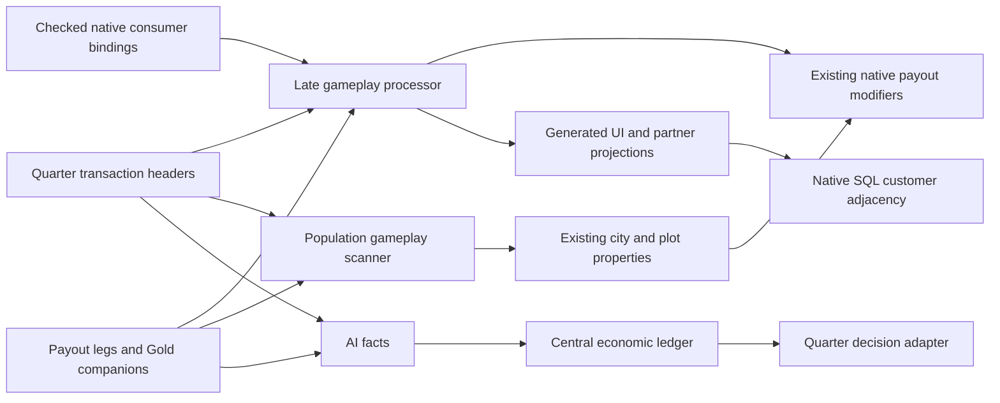

# Population building transactions: shared definitions and gameplay regression

16 November 2026. Roadmap **1.4 and 2.1**, supporting the central model for
Problems 1 and 2. Astra audited the original gaps and reviewed this first
migration. Current population gameplay is preserved against the source Henno
had already QAed.

## What changed for gameplay

| Area | Implementation change | Expected player behaviour |
| --- | --- | --- |
| Stage 3 sales | Bakery–Market and Tailor–Market/Temple terms move to gameplay-owned transaction headers and payout legs. | Same customer-population sales and recipient yields. |
| Stage 4 sales | Café–Zoo/Ferris Wheel/Conservatory and Fashion House–Amphitheater/Bolshoi/Broadway/Sydney use the same catalogue. One generic scanner replaces hardcoded venue arrays. | Same venues, ownership, thresholds and payouts. |
| Gold | Companion files append Gold legs to existing transactions. | Same Gold, without counting a shared Production/Gold property twice. |
| Native payout effects | A processor generates existing yield arguments and checks their attachments/property requirements. | Same modifier/property identities and economic effects. |
| Planning metadata | Existing customer, Wonder and Stage 3 tables become generated projections for population transactions. | UI readers receive the same existing venues. |

There is **no intentional gameplay rule change in this migration** relative to
the captured QAed source. Its source SHA is recorded in
`project/tools/transactions/population_qa_reference.json`. That source already
used the earlier **0.101 / Q8 Stage 3 precision correction**. Git's previous HEAD
still had 0.105/decimal-bit code; those existing working-tree changes are a
dependency, not a new adjustment introduced by this catalogue migration.
The separate baseline commit is `60b51107`, preserving the exact QAed Lua/Quarter
SQL before the structural migration.

Ordinary sales continue without improved materials or Service civic eligibility.
Existing gate differences remain explicit: Stage 3 and Café partners require a
functioning customer building; Fashion House district partners additionally
require an unpillaged customer district. Wonder locations come from their actual
buildings. Source building and Quarter must function. Customer population sets
demand, including cross-city sales within one player's empire.

Stage 3 sums targets once per receiving city/property, then rounds upward to a
1/256 per-citizen rate, capped at 32767 stored units. Stage 4 floors each customer
population divided by five before summation. Existing unique replacements inherit
once. The registry currently accepts only these supported population patterns;
unsupported fixed/local or fractional-leg patterns fail clearly until migrated.

Services, Mill terrain adjacency, building unlocks/costs, specialist slots,
material exchanges and trade-route gameplay are outside these gameplay edits.

## What changed for AI

The shared facts reader now includes Stage 3 venues and ordinary Wonder sales,
reads population payout legs and customer-host gates from the gameplay catalogue,
and keeps transaction identity in deduplication. The ledger uses declared yields,
quantity amounts and population steps. Quarter district quotes exclude Services
as requested. Existing actual building/repair consumers retain their prior
separate Service policy.

The customer-building marginal forecast is still diagnostic. It excludes
Services and ordinary customer/prerequisite upkeep already priced by the native
customer forecast. It does not yet provide joint multi-Quarter site valuation,
district adjacency/provider externalities or a measured native-overlap residual.
No new live customer late-write adapter is enabled. SQL private adjacency stays1.

The native customer graph now loads at3001, after population projections2500 and
adjacency tag propagation3000, including LGD declarations2005. Definitions precede
their readers; the private yield strength is unchanged.

## Architecture



Native requirement definitions are retained and checked, rather than generated
from a new universal rule language. Fixed/local exchanges, material transactions,
actual routes and observed staffing remain explicit coverage work. See the
[economic contract and full checklist](../../integrations/csc-economic-contract.md).

## Regression evidence

- **288 offline worlds** match the exact pre-migration Lua property results:
  Gold on/off, LGD present/absent, population4/5/9/10, unique Market/Hub,
  separate source/customer building/district pillage, capture, removal,
  one-supplier loss and same-city sales. Repeated refreshes are idempotent.
- **Four selected native graph comparisons match exactly**, including
  attachments, modifier definitions, requirement graphs and payout arguments:
  2278 / 2478 / 2598 / 2798 rows. These cover the migrated population consumers
  and neighboring mixed statements, not every rule in the mod.
- Existing **14 Café contract/behaviour tests** and **six Stage 3 registry tests**
  pass against the real compiled catalogue. Negative fixtures reject missing or
  inconsistent native bindings and unsupported declaration shapes. A flag-change
  fixture verifies canonical customer-district functioning affects gameplay.
- **102 central-economy tests** and **12 observer/replay tests** pass. These
  include declared yield/rate/step consumption, Service exclusion, transaction
  deduplication and prerequisite-upkeep handling.
- A shared-controller **zero-turn native250 replay** compares the captured old
  refresh in lexical isolation against the shipping refresh. **67 cities and
  42,210 city/center property/bit readings match**;269 structural census rows
  match the source save. The world includes positive Bakery/Market, Tailor
  Market/Temple, Café/Zoo and Fashion House/Amphitheater returns. Native SQL
  catalogue/binding checks load successfully. No game turn/order is issued.
- Full Tailors SQL reload into an in-memory clone of the loaded gameplay
  database passes. Its test cleanup now preserves vanilla objects whose
  descriptions mention Tailors. This is a test-loader correction.

Native artifact root:
`C:/Users/Shadow/Desktop/Codex/csc-ai-customer-transactions-20261116/population250-01`.
`complete.json` and `session-closed.json` both verify; exit0, owners absent,
preferences restored, packages archived. CE2d200ef / XP2 SHA092abfbb, unchanged
ordinary source world from the completed customer-first Continents250.

Run offline checks with the documented isolated Python/Lupa dependency:

```text
python -B -m unittest discover -s project/tools/transactions -q
python -B -m unittest discover -s project/tools/ai_economy -q
python -B -m unittest discover -s project/tools/quarter_contracts/tests -p test_stage3_customer_registry.py -q
python -B -m unittest discover -s project/tools/quarter_contracts/tests -p test_stage4_population_contract.py -q
```

## Focused manual QA after a normal CSC build

1. **Bakery + Market:** check Food in the customer city and Production/Gold in
   the seller city, same-city and cross-city. Add a second supplying Bakery and
   verify the combined customer payout/rounding.
2. **Tailor + Market + Temple:** verify both relationships count, including when
   the two customer buildings belong to one city. Check unique replacements.
3. **Café:** Zoo, Ferris Wheel and optional Conservatory at population4/5/9/10
   should yield0/1/1/2 stacks each. Several venues/sellers should stack normally.
4. **Fashion House:** check Amphitheater and each of the three Wonder venues at
   its actual plot, including several Wonders in one city. Verify ordinary sales
   before the corresponding Services are eligible.
5. **Interruptions:** pillage/remove a source or customer building, change
   ownership, restore it and reload. Returns should clear and resume. Separately
   pillage a customer district to verify the existing gate difference above.
6. Confirm planning arrows/tooltips still identify those venues. The population
   migration does not intentionally alter building availability or Services.

The zero-turn replay validates migration against a mature real world. A fresh
ordinary game with the eventual complete customer adapter remains later work.
Gold-off regressions cover these population effects; full AI Gold-off support
awaits the fixed-transaction contract migration.
